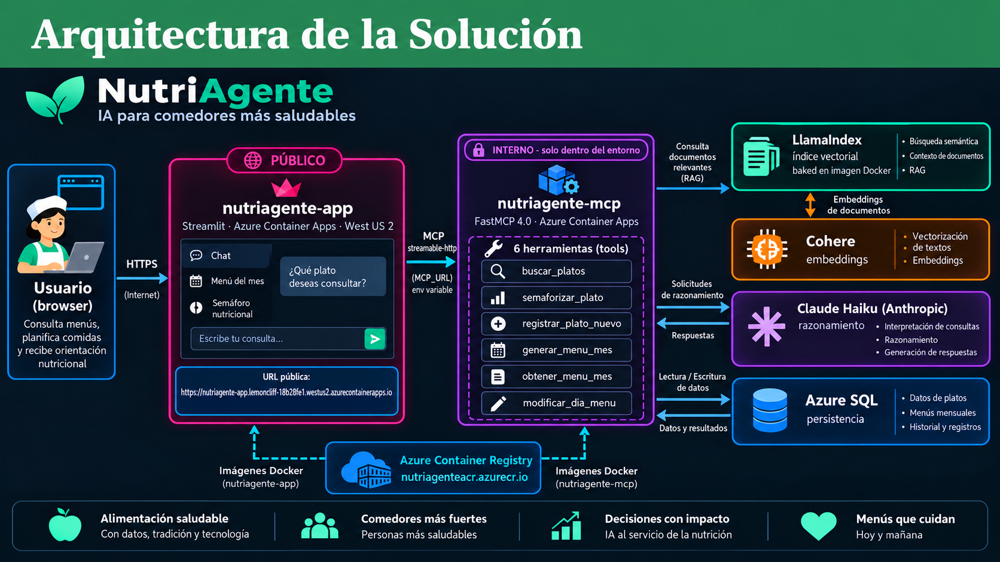

# NutriAgente 🥗

**Proyecto Módulo IV — Programa de Especialización en IA Generativa**

Agente de IA que ayuda al encargado del comedor de una planta industrial a **armar, consultar y ajustar el menú mensual** respetando un **semáforo nutricional** (Verde / Ámbar / Rojo) en 6 dimensiones.

---

## Problema

El menú del comedor se planificaba a mano en Excel:

- Sin forma de verificar el balance nutricional del mes (meta: **60 % verde · 30 % ámbar · 10 % rojo**).
- Platos que se repetían sin control.
- Consultar o cambiar un menú pasado implicaba revisar el Excel manualmente.

## Solución

Un agente conversacional: el encargado escribe en lenguaje natural ("búscame algo con pollo", "cambia el postre del día 5") y el agente decide qué herramienta usar.

- **RAG** con LlamaIndex + Cohere para buscar platos por significado (tolera errores de tipeo).
- **Claude Haiku** para entender al usuario y clasificar platos con las reglas del nutricionista.
- **Algoritmo greedy** para generar el menú del mes con balance 60/30/10 y máximo 4 repeticiones.
- **Azure SQL** para guardar menús, platos nuevos y una caché del semáforo.

---

## Arquitectura



Arquitectura de **microservicios** en Azure Container Apps:

| Servicio | Rol | Acceso |
|---|---|---|
| `nutriagente-app` (**frontend**) | Web en Streamlit (Chat, Menú del mes, Semáforo) + agente con Claude Haiku | Público |
| `nutriagente-mcp` (**backend**) | Servidor FastMCP que expone las 6 herramientas + índice vectorial | Interno |

Flujo: usuario → frontend (el agente elige la herramienta) → backend vía **MCP** (streamable-http) → LlamaIndex + Cohere / Claude Haiku / Azure SQL → respuesta.

### Tecnologías

| Tecnología | Para qué se usa |
|---|---|
| Streamlit | Interfaz web |
| LangChain + LangGraph | Construcción del agente y memoria de la conversación (MemorySaver) |
| Claude Haiku 4.5 (Anthropic) | Agente y clasificación del semáforo |
| FastMCP | Servidor MCP con las 6 herramientas |
| LlamaIndex + SimpleVectorStore | Indexación y búsqueda semántica (RAG) |
| Cohere `embed-multilingual-v3.0` | Embeddings (1024 dimensiones) |
| Azure SQL (serverless) | Persistencia: menús, platos nuevos, caché del semáforo, historial |
| Docker + Azure Container Registry + Azure Container Apps | Empaquetado y despliegue |
| LangSmith | Trazabilidad del agente |

---

## Las 6 herramientas

| Herramienta | Qué hace | Usa |
|---|---|---|
| `buscar_platos` | Búsqueda semántica en el catálogo | LlamaIndex + Cohere |
| `semaforizar_plato` | Clasifica un plato en 6 dimensiones (V/A/R) | Claude Haiku |
| `registrar_plato_nuevo` | Revisa duplicados, guarda, clasifica e indexa | LlamaIndex + Cohere, Claude Haiku, Azure SQL |
| `generar_menu_mes` | Genera el menú mensual (algoritmo greedy) | Claude Haiku (platos sin caché), Azure SQL |
| `obtener_menu_mes` | Consulta el menú de un día, rango o mes | Azure SQL |
| `modificar_dia_menu` | Cambia un plato de un día | Azure SQL |

---

## Pipeline de datos (offline)

Se ejecuta una sola vez; el índice resultante se copia a la imagen Docker del backend.

1. **`01_ingenieria_datos/Ingenieria_de_Datos.ipynb`** — ETL con `openpyxl` y `pdfplumber`: lee 3 Excel del comedor y 2 PDF del MINSA, normaliza, asigna insumo/rol/turno y elimina 32 duplicados → `platos_kb.json` (512 platos) y `reglas_semaforo.json`.
2. **`02_indexacion/Ingesta_vectorizacion_LlamaIndex_Cohere.ipynb`** — LlamaIndex: 1 plato = 1 nodo con metadata; PDFs y reglas fragmentados (512 tokens, solapamiento 50); embeddings con Cohere → 829 nodos guardados en `mcp/Base_Conocimiento/indice_platos/`.

---

## Estructura

```
M4_NutriAgente/
├── 01_ingenieria_datos/      # Notebook ETL (Archivo 1)
├── 02_indexacion/            # Notebook de vectorización (Archivo 2)
├── app/                      # Microservicio frontend (Streamlit)
├── mcp/                      # Microservicio backend (FastMCP)
│   ├── Nutriagente.py        # Lógica de las 6 herramientas
│   ├── mcp_nutriagente_server.py
│   └── Base_Conocimiento/    # platos_kb.json, reglas, SQL.sql, índice vectorial
├── Fuentes/                  # Excel y PDF de origen (ver nota)
├── docs/                     # Presentación y diagrama
└── .env.example
```

---

## Cómo ejecutarlo en local

1. Crear las tablas en Azure SQL con `mcp/Base_Conocimiento/SQL.sql`.
2. Copiar `.env.example` a `.env` y completar las variables.
3. Backend:
   ```bash
   cd mcp
   pip install -r requirements.txt
   python mcp_nutriagente_server.py      # http://localhost:8081/mcp
   ```
4. Frontend (otra terminal):
   ```bash
   cd app
   pip install -r requirements.txt
   streamlit run App_NutriAgente.py      # http://localhost:8501
   ```

Las rutas de carpetas se configuran con las variables `CARPETA_CONN`, `CARPETA_BDC`, `CARPETA_FUENTES` y `CARPETA_IDX`.

## Despliegue en Azure

```bash
az acr build --registry nutriagenteacr --image nutriagente-mcp:latest ./mcp
az acr build --registry nutriagenteacr --image nutriagente-app:latest ./app
# Luego actualizar cada Container App con la nueva imagen (nueva revisión)
```

Variables de entorno en cada Container App: ver `.env.example`. En el frontend, `MCP_URL` apunta a la URL interna del backend.

---

## Limitaciones y próximos pasos

- Llevar los filtros de metadata (rol, turno) a `buscar_platos`.
- Que `semaforizar_plato` consulte primero la caché en Azure SQL.
- Conectar `historial_chat` a la app web para memoria entre sesiones.
- Incluir los platos nuevos en el índice y en el generador de menús.
- Automatizar el despliegue (GitHub Actions).
